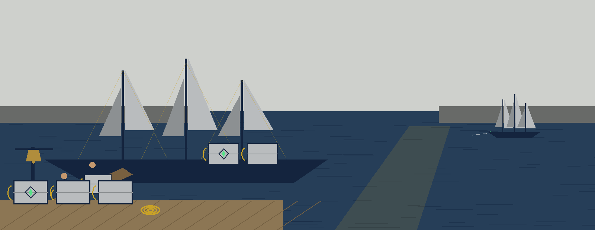
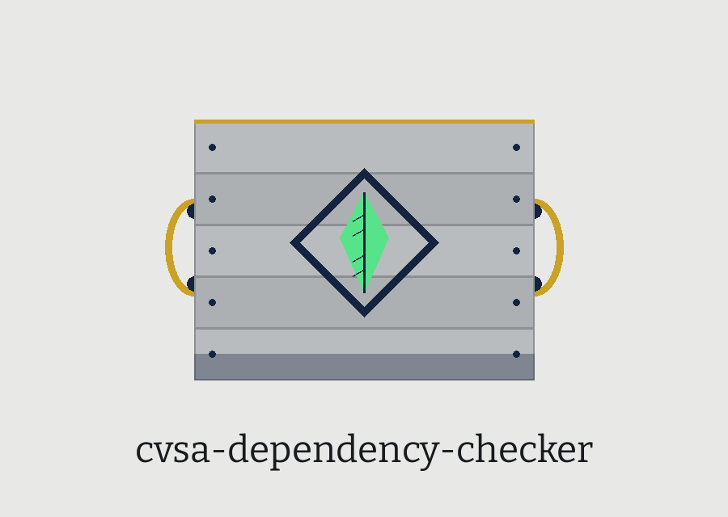

# cvsa-dependency-checker

Title block: the name above is set in Borel in midnight navy on a pale grey plate, with a ruled rope gold line beneath it and a small tea chest stencil mark kept as punctuation at the left of each heading, in the manner of a ship log entry.

# cvsa-Dependency-Checker
Lists all project dependencies and checks them against the known vulnerabilities databases (e.g., using libraries like `safety`).  Outputs a summary of vulnerabilities, if any, and suggests possible upgrade paths. - Focused on Performs static analysis of source code to identify common security vulnerabilities (e.g., injection flaws, weak cryptography usage) based on pre-defined rules and patterns. Intended for quick, preliminary security assessments during development.

## Install
`git clone https://github.com/ShadowStrikeHQ/cvsa-dependency-checker`

> Log note: global runs describe this machine, not the project. Without a virtual environment in the project, the freeze and the safety check describe the analyst machine packages.

## Usage
`./cvsa-dependency-checker [params]`

## Parameters
- `-h`: Show help message and exit
- `--report_file`: Path to save the report. If not provided, it prints to stdout.
- `--ignore`: Comma-separated list of ids to ignore, for example CVE-2023-123,PYLINT:W0613. Report lines in the Safety and Pylint sections that mention an ignored id are removed from the report.

> Log note: the style section of a saved report is a lone count. Only the pycodestyle total error count survives into the report, with no file, line, or rule behind it.

## Notes

The report includes a Dependencies section holding the pip freeze output. When the project has a .venv, the freeze and the safety check both run with that venv's own executables, called directly by path with no shell, and they describe the venv environment. The project path is resolved to an absolute path before any command runs, so relative and absolute paths behave the same. An invalid project path exits 1, and a run where the dependency check never ran also exits 1.

> Log note: safety failure still prints a report, then exits 1. The safety section carries the error text, and the run ends at exit 1 after the report prints.

## License
Copyright (c) ShadowStrikeHQ

> Log note: the README licence line and the LICENSE file do not name the same holder. The LICENSE file carries the MIT License, and its holder line gives a pen name together with a single initial for the remaining name.

## Log notes, gathered at the manifest

The buttons of this re-skin read Check the Project, Save the Report, Apply the Ignore List, and Show the Log Notes. Its headings read Two Halves, One Report, Global Means This Machine, A Count With Nothing Behind It, and Ran, or Never Ran. Two facts are entered once more at full size: the program suggests no upgrade path of its own and passes any upgrade words in the safety tool output through unchanged, and a safety return code of 3, if the safety tool itself returns one, is recorded as inconclusive, since this program does not pass safety codes through and its own exits are 0 and 1.
